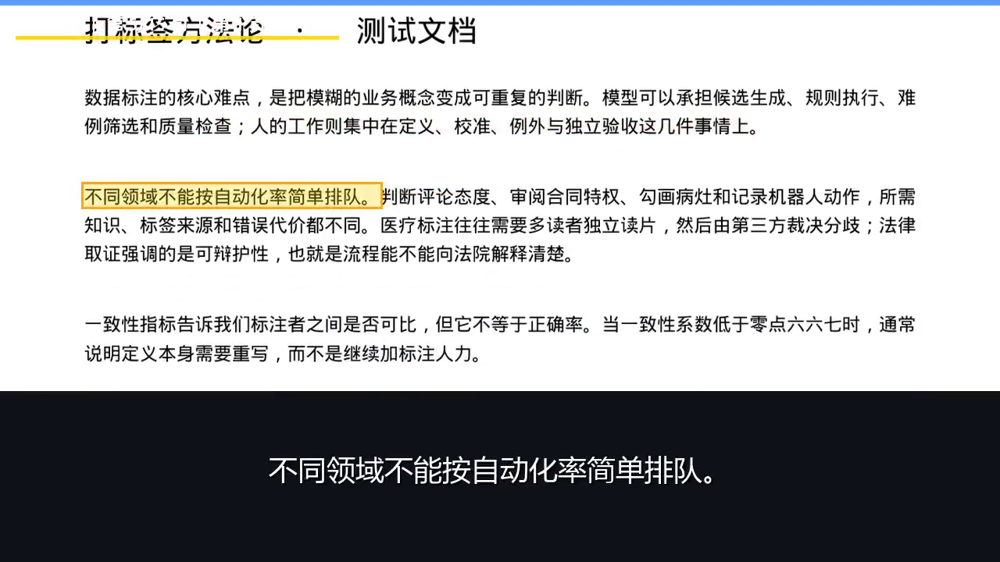

# PDF 高亮跟读视频 / PDF Readalong

一个面向**需要反复制作讲义视频的老师、知识分享者**的 Windows 桌面工具：把有文本层的 PDF 变成「朗读 + 逐行高亮跟读 + 大字幕」的视频，通过本机浏览器操作。

**English:** Turn text-based PDFs into narrated videos with line-by-line highlighting and large subtitles. Built for teachers and knowledge creators on Windows; controlled through a local browser UI.

## 先看效果 / See it in action

下面是本轮直接从仓库源码生成的视频第 20 秒原始帧，保留实际画面，没有重新排版：



真实输入：[测试文档.pdf](assets/测试文档.pdf)，2 页《打标签方法论 · 测试文档》。本轮提取 **15 个朗读单元、437 字**，云希音色、默认语速，产出一卷视频、纯音频及字幕：

| 输入 / 输出 | 本机记录 |
|---|---|
| 输入 PDF | 3,241 字节、2 页 |
| `测试文档_第1卷.mp4` | **1280×720 / 30fps / 2,583 帧 / 86.130 秒**；H.264 + AAC；2,345,781 字节 |
| `测试文档_第1卷_纯音频.mp3` | 689,709 字节 |
| `测试文档_第1卷.srt` | 1,882 字节、15 条字幕 |

音视频保存在本机 `jobs/source-smoke/`，按仓库规则不提交。可用下方已验证命令自行生成；文件证据及 SHA256 见 [样例记录](assets/demo-evidence.md)。网页上传则在 `jobs/<作业ID>/` 保存产物，页面提供视频、音频和字幕下载。

还有两组已有结果，**不要把录屏规格当成导出视频规格**：

| 已有材料 | 规格及来源 |
|---|---|
| 既有验收讲义成片 | **1280×720 / 30fps / 5,266 帧 / 175.55 秒**；项目交接中已确认，本轮直接采用，未重新测量；对应输入和文件标识待发布者补齐 |
| 完整流程演示录屏 | 存档文件 `演示_全流程_修复版_83.1s.mp4`：本轮读取文件确认 **1280×896 / 20fps / 1,663 帧 / 83.150 秒**；不是 720p 导出视频 |

另一个可公开输入是 [演示文档.pdf](assets/演示文档.pdf)，3 页《长文档音频化：方法与取舍》，本轮确认可提取 36 个单元、915 字。它对应已有流程演示；本轮没有重新生成该文件的完整视频。演示视频尚未放入仓库，也尚未提供公开视频 URL。

## 从源码开始 / Run from source

本轮验证环境：**Windows 10 x64（19045）、CPython 3.12.10、FFmpeg / ffprobe 8.1.1 essentials build**。运行依赖锁定在 [requirements.txt](requirements.txt)；这个源码版本提供在线 `edge-tts` 语音模式。

先自行安装 Python 3.12（带 Windows `py` 启动器）及含 `ffmpeg.exe`、`ffprobe.exe` 的 FFmpeg，将后两者加入 PATH。系统需要 `C:/Windows/Fonts/msyh.ttc` 和 `msyhbd.ttc`。这几项的安装过程**未在干净机器验证**；本机已有这些工具，不提供未经验证的安装命令。

公开仓库：**https://github.com/user3868/pdf-readalong**。可以直接 `git clone https://github.com/user3868/pdf-readalong.git`，或在仓库页面下载 Source ZIP 后解压。以下命令全部在 **PowerShell** 实际执行通过；若把源码放在别处，只调整第一行：

```powershell
Set-Location pdf-readalong
py -3.12 --version
py -3.12 -m venv .venv
./.venv/Scripts/python.exe -m pip install -r requirements.txt
$env:FFMPEG = (Get-Command ffmpeg.exe).Source.Replace('\', '/')
$env:FFPROBE = (Get-Command ffprobe.exe).Source.Replace('\', '/')
& $env:FFMPEG -version
& $env:FFPROBE -version
./.venv/Scripts/python.exe -m pip check
./.venv/Scripts/python.exe -m uvicorn app:app --host 127.0.0.1 --port 18756
```

服务持续运行时，在浏览器打开 **http://127.0.0.1:18756/**，上传上述 PDF，选择音色及语速，再生成视频。最后一条命令已验证服务启动及首页 HTTP 200；本轮未用浏览器完成上传点击流程。用 `Ctrl+C` 停止服务。本示例绑定本机地址；只建议作为本地工具使用。

命令行生成也已完整跑通。停止服务或另开同一源码目录的 PowerShell，使用相同的 FFmpeg 环境配置：

```powershell
./.venv/Scripts/python.exe pipeline.py --help
./.venv/Scripts/python.exe pipeline.py "assets/测试文档.pdf" -o jobs/source-smoke
```

本机命令行生成使用代码默认的 `C:/ProgramData/chocolatey/bin/ffmpeg.exe` 和 `ffprobe.exe`；其他安装位置请沿用上面的 `FFMPEG` / `FFPROBE` 设置。当前代码调用 FFmpeg 的方式对**含空格的可执行文件路径未验证**，推荐选择不含空格的工具路径。

Windows + Git Bash 用户请在 PowerShell 执行本页示例。传给原生 `python.exe` / `git.exe` / `ffmpeg.exe` 的绝对路径应写成 `D:/...`，不要传 `/d/...`；中文文件名优先由 Python subprocess 参数列表传递。本页没有提供未经本轮验证的 Bash 命令。

## 它如何工作 / How it works

PyMuPDF 从 PDF 文本层取出文字及坐标，按句组织朗读单元；在线语音逐句合成，解码为 PCM 并裁切首尾静音。Pillow 在原页上绘制逐行高亮和字幕，FFmpeg 将帧与音频合成为 MP4，并输出 MP3 和 SRT。长材料可按界面设置分卷，默认单卷上限为 9.5 分钟。

核心入口是 `app.py` 和 `pipeline.py`。录屏、测量与 `history/` 文件用于开发追溯，部分脚本带作者本机路径和额外依赖，不属于上述运行入口。

## 已知限制 / Limitations

- **只建议用于已经测过的文件和系统。** 本轮完整转换只验证 2 页测试 PDF；3 页演示 PDF只验证提取。其他 Windows 版本、复杂多栏、公式、密集表格和任意客户讲义尚未全面测试。
- 必须有可提取文本层；扫描件需要先做 OCR，本项目没有内置 OCR。断句、表格读序和内容准确性需要人工检查。
- 当前在线模式需要联网，朗读文本会发送给语音服务；网络、服务可用性及条款可能影响使用。代码遇到语音失败可能跳过句子，请核对字幕条数与输入单元，不要仅凭进度完成判断内容完整。
- 背景中的本地语音模式需另下载**约 2.4GB 模型**；**当前版本仓库没有 `tts_local.py` 或本地模式**，本轮未下载、未测试，也未确认模型名称和许可。不能把这条当作当前源码可用的离线功能承诺。
- 超长句的画面字幕最多绘制 3 行；顶部白色信息文字可能与白底 PDF 内容重叠。当前截图可见顶部可读性问题，本轮只准备材料，没有修复运行代码。
- 本轮未记录转换耗时或 RTF，没有性能基准；也未验证视频导出与声画同步在所有文件上的表现。

## 许可、完整源码与付费包 / License and source

本项目原创代码按 **AGPL-3.0-only** 提供，全文见 [LICENSE](LICENSE)。第三方组件保留各自的许可和版权，详见 [依赖许可说明](THIRD_PARTY_NOTICES.md)。

**PyMuPDF / MuPDF 是 AGPL-3.0 或 Artifex 商业许可双许可；本项目走 AGPL 分支。** 分发受覆盖的程序及其修改版，须履行相应版权声明、许可和完整对应源码（Corresponding Source）义务。二进制分发关注第 6 条；修改版提供远程网络交互时还须按第 13 条显著提供该版本源码获取机会。不能只附许可文本、提供旧代码或藏起受覆盖的付费版实现。[PyMuPDF 官方许可说明](https://pymupdf.readthedocs.io/en/latest/about.html#license-and-copyright)、[AGPL 正文](https://www.gnu.org/licenses/agpl-3.0.html)。

**源码获取：** 公开仓库 **https://github.com/user3868/pdf-readalong** 包含当前版本代码、依赖锁定文件及运行说明，读者可从仓库页面下载 Source ZIP 或直接 `git clone`。付费包的下载页必须同时给出匹配实际分发版本、无需额外付费的完整对应源码入口，包括适用的构建/安装脚本及依赖源码交付；当前仓库尚未与正在收尾的付费包完成核对。详情见 [发布检查清单](发布检查清单.md)。

**代码免费；39 元的一键便携包用于支持作者。** 它把便携 Python、FFmpeg 和应用运行环境预先配好，省去自行安装 Python、配置虚拟环境、安装依赖及配置 FFmpeg 路径的步骤，解压即可使用。已有便携包体积为 **284–298 MB**（交接确认范围，本轮未重测；不同打包产物可能不同），不等于已包含约 2.4GB 的本地语音模型。购买入口尚未设置。

收费针对已打包交付的便利和支持，不改变 AGPL/GPL 赋予接收者的源码、修改和再分发权利。本源码仓库不附便携运行时、安装包、模型、测试音视频或用户作业；**这种仓库内容安排不免除受覆盖付费包的完整源码交付义务**。

**English:** Original project code is AGPL-3.0-only. PyMuPDF/MuPDF uses its AGPL branch here. Covered binary distributions require matching Corresponding Source; modified versions supporting remote network interaction must satisfy section 13. The optional RMB 39 portable bundle pays for packaging convenience and support, without restricting license-granted redistribution rights. Its source-to-binary mapping remains a release blocker.
